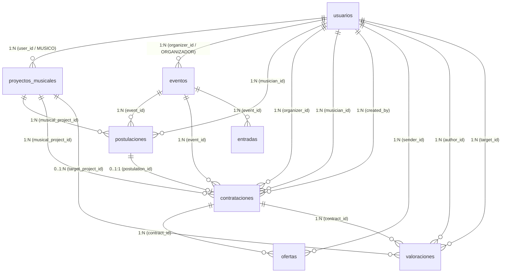

# Documentación de Base de Datos — Arma tu pogo

## 1. Descripción y Arquitectura

Este documento describe la arquitectura de la base de datos relacional PostgreSQL para **Arma tu pogo**, modelada mediante **Prisma ORM** y alojada en la infraestructura administrada de PostgreSQL (Supabase), implementada en conformidad con `docs/spec.md` y `AGENTS.md`.

El esquema declarativo y las relaciones de la base de datos se gestionan a través de:
* `prisma/schema.prisma` (definición canónica y autoritativa de modelos, enums, índices y relaciones).
* `prisma/migrations/` (historial versionado de migraciones reproducibles del modelo relacional).
* `lib/prisma.ts` (cliente singleton de Prisma para Next.js App Router).

La infraestructura externa que excede el alcance del ORM (buckets de Supabase Storage y políticas de Row Level Security para archivos) se versiona por separado en `supabase/migrations/`.

---

## 2. Diagrama Entidad-Relación



---

## 3. Especificación Detallada de Tablas y Modelos

### 3.1 `usuarios` (Modelo Prisma: `Usuario`)
Almacena el perfil del usuario autenticado, su rol en el sistema y datos de contacto.

| Columna | Tipo | Constraints / Default | Descripción |
|---|---|---|---|
| `id` | `UUID` | `PRIMARY KEY` | Identificador único provisto por Supabase Auth |
| `email` | `TEXT` | `NOT NULL, UNIQUE` | Correo electrónico del usuario |
| `first_name` | `TEXT` | `NOT NULL` | Nombre |
| `last_name` | `TEXT` | `NOT NULL` | Apellido |
| `role` | `RolUsuario` | `NOT NULL` | Rol (`MUSICO`, `ORGANIZADOR`) |
| `avatar_url` | `TEXT` | `NULL` | URL de la imagen de perfil |
| `bio` | `TEXT` | `NULL` | Biografía o presentación |
| `phone` | `TEXT` | `NULL` | Teléfono de contacto |
| `created_at` | `TIMESTAMPTZ` | `NOT NULL, DEFAULT NOW()` | Fecha de registro en el sistema |
| `updated_at` | `TIMESTAMPTZ` | `NOT NULL, DEFAULT NOW()` | Fecha de última actualización |

---

### 3.2 `proyectos_musicales` (Modelo Prisma: `ProyectoMusical`)
Representa bandas, solistas o propuestas artísticas administradas por un usuario con rol `MUSICO`.

| Columna | Tipo | Constraints / Default | Descripción |
|---|---|---|---|
| `id` | `UUID` | `PRIMARY KEY, DEFAULT gen_random_uuid()` | Identificador del proyecto |
| `user_id` | `UUID` | `NOT NULL, REFERENCES usuarios(id) ON DELETE CASCADE` | Músico propietario |
| `name` | `TEXT` | `NOT NULL` | Nombre artístico del proyecto |
| `description` | `TEXT` | `NULL` | Reseña y propuesta musical |
| `genre` | `TEXT` | `NOT NULL` | Género musical |
| `approximate_cache` | `NUMERIC(12, 2)` | `NULL` | Caché orientativo de referencia |
| `location` | `TEXT` | `NULL` | Zona o barrio |
| `city` | `TEXT` | `NULL` | Ciudad |
| `image_url` | `TEXT` | `NULL` | URL de imagen en Supabase Storage |
| `spotify_url` | `TEXT` | `NULL` | Enlace a Spotify |
| `youtube_url` | `TEXT` | `NULL` | Enlace a YouTube |
| `instagram_url` | `TEXT` | `NULL` | Enlace a Instagram |
| `website_url` | `TEXT` | `NULL` | Sitio web o Linktree |
| `custom_links` | `JSONB` | `DEFAULT '[]'::jsonb` | Enlaces adicionales personalizados |
| `is_active` | `BOOLEAN` | `NOT NULL, DEFAULT TRUE` | Baja lógica del proyecto |
| `created_at` | `TIMESTAMPTZ` | `NOT NULL, DEFAULT NOW()` | Fecha de creación |
| `updated_at` | `TIMESTAMPTZ` | `NOT NULL, DEFAULT NOW()` | Fecha de actualización |

---

### 3.3 `eventos` (Modelo Prisma: `Evento`)
Recitales o fechas creados y publicados por un usuario con rol `ORGANIZADOR`.

| Columna | Tipo | Constraints / Default | Descripción |
|---|---|---|---|
| `id` | `UUID` | `PRIMARY KEY, DEFAULT gen_random_uuid()` | Identificador del evento |
| `organizer_id` | `UUID` | `NOT NULL, REFERENCES usuarios(id) ON DELETE CASCADE` | Organizador responsable |
| `title` | `TEXT` | `NOT NULL` | Título del recital / fecha |
| `description` | `TEXT` | `NULL` | Descripción del evento |
| `starts_at` | `TIMESTAMPTZ` | `NOT NULL` | Fecha y hora de inicio |
| `ends_at` | `TIMESTAMPTZ` | `NOT NULL` | Fecha y hora de finalización |
| `location` | `TEXT` | `NOT NULL` | Dirección o ubicación |
| `venue_name` | `TEXT` | `NULL` | Nombre del recinto, bar o club |
| `city` | `TEXT` | `NULL` | Ciudad |
| `required_musicians_count` | `INTEGER` | `NOT NULL, DEFAULT 1` | Cupo total de bandas requeridas |
| `offered_cache` | `NUMERIC(12, 2)` | `NULL` | Caché ofrecido orientativo |
| `status` | `EstadoEvento` | `NOT NULL, DEFAULT 'PUBLICADO'` | Estado (`PUBLICADO`, `CANCELADO`) |
| `banner_url` | `TEXT` | `NULL` | Flyer / imagen en Supabase Storage |
| `created_at` | `TIMESTAMPTZ` | `NOT NULL, DEFAULT NOW()` | Fecha de creación |
| `updated_at` | `TIMESTAMPTZ` | `NOT NULL, DEFAULT NOW()` | Fecha de actualización |

---

### 3.4 `postulaciones` (Modelo Prisma: `Postulacion`)
Postulación de un proyecto musical a un evento publicado. Permite al organizador evaluar la propuesta antes de iniciar la negociación contractual.

| Columna | Tipo | Constraints / Default | Descripción |
|---|---|---|---|
| `id` | `UUID` | `PRIMARY KEY, DEFAULT gen_random_uuid()` | Identificador de la postulación |
| `event_id` | `UUID` | `NOT NULL, REFERENCES eventos(id) ON DELETE CASCADE` | Evento postulado |
| `musical_project_id` | `UUID` | `NOT NULL, REFERENCES proyectos_musicales(id) ON DELETE RESTRICT` | Proyecto musical postulante |
| `musician_id` | `UUID` | `NOT NULL, REFERENCES usuarios(id) ON DELETE RESTRICT` | Músico titular de la postulación |
| `status` | `EstadoPostulacion` | `NOT NULL, DEFAULT 'PENDIENTE'` | Estado (`PENDIENTE`, `ACEPTADA`, `RECHAZADA`, `CANCELADA`) |
| `message` | `TEXT` | `NULL` | Mensaje o presentación del postulante |
| `created_at` | `TIMESTAMPTZ` | `NOT NULL, DEFAULT NOW()` | Fecha de postulación |
| `updated_at` | `TIMESTAMPTZ` | `NOT NULL, DEFAULT NOW()` | Fecha de actualización |

* **Unique Constraint:** `@@unique([eventoId, proyectoMusicalId])` en BD (`event_id`, `musical_project_id`). Un proyecto no puede postularse más de una vez al mismo evento.
* **Relación:** Cuando una postulación es aceptada por el organizador, se crea una fila en `contrataciones` con `postulation_id` apuntando a esta postulación.

---

### 3.5 `contrataciones` (Modelo Prisma: `Contratacion`)
Contrato y proceso de negociación entre organizador y proyecto musical. Puede originarse a partir de una postulación aceptada o mediante invitación directa del organizador.

| Columna | Tipo | Constraints / Default | Descripción |
|---|---|---|---|
| `id` | `UUID` | `PRIMARY KEY, DEFAULT gen_random_uuid()` | Identificador de la contratación |
| `event_id` | `UUID` | `NOT NULL, REFERENCES eventos(id) ON DELETE CASCADE` | Evento al que aplica |
| `musical_project_id` | `UUID` | `NOT NULL, REFERENCES proyectos_musicales(id) ON DELETE RESTRICT` | Proyecto contratado/convocado |
| `postulation_id` | `UUID` | `NULL, UNIQUE, REFERENCES postulaciones(id) ON DELETE SET NULL` | Postulación origen (si provino de postulación) |
| `organizer_id` | `UUID` | `NOT NULL, REFERENCES usuarios(id) ON DELETE RESTRICT` | Organizador contratante |
| `musician_id` | `UUID` | `NOT NULL, REFERENCES usuarios(id) ON DELETE RESTRICT` | Músico titular contratado |
| `status` | `EstadoContratacion` | `NOT NULL, DEFAULT 'NEGOCIANDO'` | Estado (`NEGOCIANDO`, `ACORDADO`, `CANCELADO`, `COMPLETADO`) |
| `agreed_amount` | `NUMERIC(12, 2)` | `NULL` | Monto definitivo pactado al aceptar una oferta |
| `agreed_at` | `TIMESTAMPTZ` | `NULL` | Fecha y hora en que se alcanzó el acuerdo |
| `cancelled_at` | `TIMESTAMPTZ` | `NULL` | Fecha y hora de cancelación |
| `cancellation_reason` | `TEXT` | `NULL` | Motivo de la cancelación |
| `created_by` | `UUID` | `NOT NULL, REFERENCES usuarios(id) ON DELETE RESTRICT` | Usuario que inició la contratación/invitación |
| `created_at` | `TIMESTAMPTZ` | `NOT NULL, DEFAULT NOW()` | Fecha de creación del contrato |
| `updated_at` | `TIMESTAMPTZ` | `NOT NULL, DEFAULT NOW()` | Fecha de actualización |

* **Unique Constraint:** `@@unique([eventoId, proyectoMusicalId])` en BD (`event_id`, `musical_project_id`). No pueden coexistir dos contratos para el mismo evento y proyecto.

---

### 3.6 `ofertas` (Modelo Prisma: `Oferta`)
Historial de propuestas y contrapropuestas económicas intercambiadas dentro de una contratación en estado `NEGOCIANDO`.

| Columna | Tipo | Constraints / Default | Descripción |
|---|---|---|---|
| `id` | `UUID` | `PRIMARY KEY, DEFAULT gen_random_uuid()` | Identificador de la oferta |
| `contract_id` | `UUID` | `NOT NULL, REFERENCES contrataciones(id) ON DELETE CASCADE` | Contratación asociada |
| `sender_id` | `UUID` | `NOT NULL, REFERENCES usuarios(id) ON DELETE RESTRICT` | Remitente de la oferta económica |
| `amount` | `NUMERIC(12, 2)` | `NOT NULL` | Monto propuesto |
| `message` | `TEXT` | `NULL` | Mensaje o condiciones propuestas |
| `status` | `EstadoOferta` | `NOT NULL, DEFAULT 'PROPUESTA'` | Estado (`PROPUESTA`, `ACEPTADA`, `RECHAZADA`, `CONTRAOFERTADA`) |
| `created_at` | `TIMESTAMPTZ` | `NOT NULL, DEFAULT NOW()` | Fecha de envío |
| `updated_at` | `TIMESTAMPTZ` | `NOT NULL, DEFAULT NOW()` | Fecha de actualización |

---

### 3.7 `valoraciones` (Modelo Prisma: `Valoracion`)
Reseñas y puntajes mutuos entre organizador y músico tras una contratación en estado `COMPLETADO`.

| Columna | Tipo | Constraints / Default | Descripción |
|---|---|---|---|
| `id` | `UUID` | `PRIMARY KEY, DEFAULT gen_random_uuid()` | Identificador de la valoración |
| `contract_id` | `UUID` | `NOT NULL, REFERENCES contrataciones(id) ON DELETE CASCADE` | Contratación que respalda la reseña |
| `author_id` | `UUID` | `NOT NULL, REFERENCES usuarios(id) ON DELETE RESTRICT` | Usuario que califica |
| `target_id` | `UUID` | `NOT NULL, REFERENCES usuarios(id) ON DELETE RESTRICT` | Usuario evaluado |
| `target_project_id` | `UUID` | `NULL, REFERENCES proyectos_musicales(id) ON DELETE SET NULL` | Proyecto evaluado (cuando califica el organizador) |
| `score` | `INTEGER` | `NOT NULL` | Puntaje de 1 a 5 estrellas |
| `comment` | `TEXT` | `NULL` | Comentario opcional |
| `created_at` | `TIMESTAMPTZ` | `NOT NULL, DEFAULT NOW()` | Fecha de emisión |
| `updated_at` | `TIMESTAMPTZ` | `NOT NULL, DEFAULT NOW()` | Fecha de actualización |

* **Unique Constraint:** `@@unique([contratacionId, autorId])` en BD (`contract_id`, `author_id`). Cada parte sólo puede emitir una única valoración por contratación.

---

### 3.8 `entradas` (Modelo Prisma: `Entrada`)
Información pública y orientativa sobre entradas y localidades del evento (alcance informativo del MVP).

| Columna | Tipo | Constraints / Default | Descripción |
|---|---|---|---|
| `id` | `UUID` | `PRIMARY KEY, DEFAULT gen_random_uuid()` | Identificador de la entrada |
| `event_id` | `UUID` | `NOT NULL, REFERENCES eventos(id) ON DELETE CASCADE` | Evento asociado |
| `ticket_type` | `TEXT` | `NOT NULL, DEFAULT 'GENERAL'` | Tipo (GENERAL, VIP, ANTICIPADA, etc.) |
| `price` | `NUMERIC(12, 2)` | `NOT NULL, DEFAULT 0` | Precio informativo |
| `capacity` | `INTEGER` | `NULL` | Capacidad prevista |
| `description` | `TEXT` | `NULL` | Observaciones de la entrada |
| `external_purchase_url` | `TEXT` | `NULL` | Enlace externo para adquisición de tickets |
| `is_free` | `BOOLEAN` | `NOT NULL, DEFAULT FALSE` | Flag de gratuidad |
| `created_at` | `TIMESTAMPTZ` | `NOT NULL, DEFAULT NOW()` | Fecha de creación |
| `updated_at` | `TIMESTAMPTZ` | `NOT NULL, DEFAULT NOW()` | Fecha de actualización |

---

## 4. Reglas de Base de Datos vs. Reglas de Aplicación

Para mantener la solución simple, predecible y portable:

1. **Gobernadas por la Base de Datos:**
   * Tipos de datos, nulabilidades y valores por defecto.
   * Claves primarias UUID (`gen_random_uuid()`).
   * Claves foráneas e integridad referencial (`CASCADE`, `RESTRICT`, `SET NULL`).
   * Restricciones de unicidad:
     * `usuarios(email)`
     * `postulaciones(event_id, musical_project_id)`
     * `contrataciones(event_id, musical_project_id)`
     * `contrataciones(postulation_id)`
     * `valoraciones(contract_id, author_id)`
   * Enums nativos PostgreSQL (`RolUsuario`, `EstadoEvento`, `EstadoPostulacion`, `EstadoContratacion`, `EstadoOferta`).

2. **Gobernadas por la Capa de Aplicación / Servicios:**
   * **Validación de esquemas:** Zod valida tipos, rangos, longitudes y formatos de datos antes de consultar la base.
   * **Disponibilidad de agenda del músico:** Validación horaria para evitar solapamientos con otros eventos acordados. Se ejecuta dentro de una transacción `Serializable` con reintentos acotados ante `P2034` en `acceptOfferAsCounterparty`.
   * **Cupo máximo de bandas:** Validación atómica de bandas acordadas contra `required_musicians_count`, garantizada dentro de la transacción Serializable en `acceptOfferAsCounterparty`.
   * **Validación de contraparte en ofertas:** Solo el destinatario de la propuesta puede aceptarla o contraofertarla.
   * **Habilitación de valoraciones:** Solo habilitada cuando el contrato está en estado `COMPLETADO`.
   * **Control de rangos numéricos:** Puntajes (1 a 5) y montos no negativos validados por Zod.

---

## 5. Estrategia de Migraciones

La gestión de cambios en la base de datos sigue una estricta separación de responsabilidades:

### 5.1 Modelo de Negocio (Prisma Migrate)

* **Fuente autoritativa:** `prisma/schema.prisma`.
* **Historial de migraciones:** `prisma/migrations/**`.
  * Migración canónica inicial: `prisma/migrations/20260909020221_init/migration.sql`.
* **Despliegue en producción y nuevos entornos:**
  ```bash
  npx prisma migrate deploy
  ```
* **Evolución en desarrollo:**
  Al modificar `prisma/schema.prisma`, crear una nueva migración reproducible:
  ```bash
  npx prisma migrate dev --name <descripcion_del_cambio>
  ```
* **Inspección del estado de migraciones:**
  ```bash
  npx prisma migrate status
  ```

### 5.2 Infraestructura Supabase (Storage & RLS)

Los scripts SQL específicos de Supabase se ubican en `supabase/migrations/` y están estrictamente reservados para infraestructura que Prisma no modela:
* `supabase/migrations/202610260002_project_images_storage.sql`: Creación del bucket `project-images`, funciones y políticas RLS para subida y borrado de imágenes de proyectos musicales.
* `supabase/migrations/202610260003_event_images_storage.sql`: Creación del bucket `event-images`, funciones y políticas RLS para flyers de eventos.

> **IMPORTANTE — Historial de Supabase CLI:**
> Los scripts de Storage están versionados en el repositorio, pero el historial de Supabase CLI no está normalizado (la base remota conserva la migración histórica `00001` de etapas previas y los buckets fueron aplicados mediante el editor SQL).
> **No ejecutar `supabase db push`, `supabase migration repair` ni asumir sincronización automática mediante CLI** sin realizar previamente una tarea formal de normalización del historial.
> Si se inicializa un entorno desde cero, ejecutar los scripts de Storage manualmente a través del Supabase SQL Editor tras haber aplicado `npx prisma migrate deploy`.
> Estos scripts **nunca deben volver a definir tablas de negocio**.